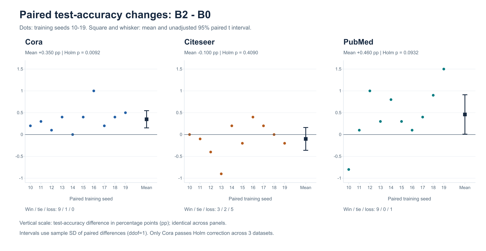
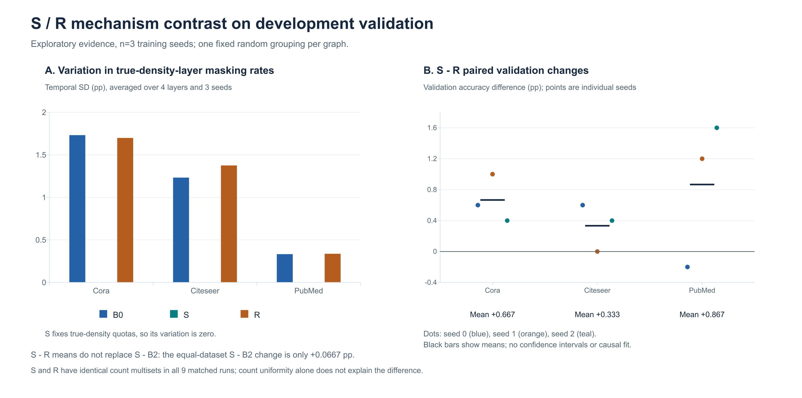
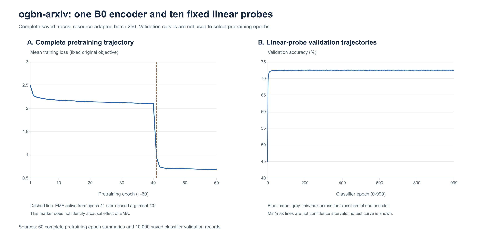

# GraphMAE2复现与输入掩码课程改进

课程报告 · 内容版 · 2026年11月8日（北京时间）

## 摘要

本项目基于GraphMAE2官方实现，在Cora、Citeseer和PubMed三个引用网络上复现小图全批次预训练与线性探测，并研究输入端掩码节点的选择策略。主方案B2使用对数度数评分与渐进引导课程，保持骨干、损失、教师和解码机制不变。在三数据集、四方法、十训练种子的120次正式比较中，B2相对同批均匀随机基准B0的测试准确率均值变化依次为+0.35、−0.10、+0.46个百分点；只有Cora通过三项主要比较的Holm校正。后续密度分层、误差反馈、学习进展代理和联合掩码探索没有形成可升级为正式主结果的稳定额外收益。另在ogbn-arxiv完成1次独立B0资源适配预训练及10个固定种子的线性探测，测试准确率为71.542±0.054%（总体标准差来自同一编码器的分类器随机性），完整任务耗时约15.14小时。未进行B2大图迁移比较。本报告同时保留负结果、工程核验范围和固定划分下的统计限制。项目贡献是可追溯的课程复现、一个有限有效的输入掩码改进及其机制对照，不构成GraphMAE2整篇论文的全量复现。

关键词：图自监督学习；GraphMAE2；输入掩码；结构课程；配对实验

## 1. 研究问题与复现范围

图上的自监督预训练利用结构和节点特征构造训练信号，再通过少量标签评价表示质量。本项目选择GraphMAE2作为复现基准，关注一个具体问题：在总掩码数和训练预算固定时，改变“遮住哪些节点”是否能改善下游分类？

本项目完成三个小图上的官方配置复现和输入掩码对照，并补充ogbn-arxiv上的B0资源适配复现。固定上游提交为`bc473e8b750d6e90b7cba1c6bb20d858f617d90c`。原论文还包含大规模图、其他评估设置和组件研究；本项目没有完成这些全部实验，也没有独立重跑所有论文比较方法。[GraphMAE2论文](https://arxiv.org/abs/2304.04779)、[固定上游代码](https://github.com/THUDM/GraphMAE2/tree/bc473e8b750d6e90b7cba1c6bb20d858f617d90c)。

主要完整训练账本为60次历史基线、120次正式比较、36次初始开发、R/DS/C各9次及P/J各12次，共267次。筛选、冒烟、回归和100轮诊断另计。267是原小图运行账本，另登记本次1个arxiv独立编码器，合计268次主要完整预训练；10次arxiv分类器另计。历史与正式批次还使用了部分相同种子，268也不能解释为268个独立统计样本。2026年11月6日起停止新增小图方法搜索，以B2作为报告主方案；该收尾决定不等于实验前预注册。

## 2. 原方法与本项目修改的边界

GraphMAE2首先遮蔽输入节点特征，用GNN编码器生成表示，再进行特征重构。原论文的两个关键设计是多视图随机重掩码解码，以及以未遮蔽输入特征的教师视图生成目标表示的潜在表征预测；后者提供表示空间的训练约束。二者都是原论文设计。[原论文方法部分](https://arxiv.org/html/2304.04779v1#S2)。

本项目遵循官方小图配置，其实际解码设置为`remask_method=fixed`，保留原有潜在预测分支及教师更新。arxiv单独沿用官方大图设置，使用random重掩码3次，不能将大小图解码配置混写。论文提出随机重掩码，不意味着当前三个小图配置实际启用了随机解码消融；本项目也不能以这些结果代替对原文随机重掩码组件的独立验收。实现可对照[固定版本模型文件](https://github.com/THUDM/GraphMAE2/blob/bc473e8b750d6e90b7cba1c6bb20d858f617d90c/models/edcoder.py)。

本项目修改的是输入节点选择器，以及为它提供独立课程进度和统计记录的接口。总掩码率、损失、教师参数、编码器、解码器和官方训练轮数在每个匹配比较内保持一致。标签不进入输入掩码评分。保存模型、配置、源码快照及其哈希，是本项目的复现工程工作，不是原论文的新学习目标。

## 3. 主方案B2：对数度数引导的输入掩码课程

### 3.1 动机与定义

节点度数是廉价、无需标签的结构代理。对数变换降低高度节点对权重的支配程度，课程则在训练早期保留均匀选择，随后逐渐引入结构偏好。“结构评分＋渐进掩码”的动机可参考StructMAE，但本项目使用下述固定的度数混合采样，并未复刻其完整模型或评分器；相关工作本身不保证本次迁移有效。[StructMAE论文](https://ijcai.org/proceedings/2024/241)。

设预处理图有N个节点，d_i为去除自环后的入度，epsilon=1e−8，掩码率为r。每轮无放回抽取恰好K个节点：

```text
K = floor(r * N)
q_i = [log(1 + d_i) + epsilon] / sum_j[log(1 + d_j) + epsilon]
u = epoch / max(total_epochs - 1, 1)
alpha(u) = 0.5 * clip((u - 0.2) / 0.6, 0, 1)
w_i(u) = (1 - alpha(u)) / N + alpha(u) * q_i
```

前20%训练进度均匀随机，中间60%线性增加引导，最后20%将引导强度保持在0.5。alpha改变采样偏好，不改变总掩码率。w是无放回采样的输入权重，不能写成每个节点精确的边缘入选概率；度数也不能直接等同真实重构难度。课程进度通过独立接口传递，不改变原forward的epoch或教师更新含义。

### 3.2 正式对照设计

| 方法 | 输入节点选择 | 检验目的 |
| --- | --- | --- |
| B0 | 原始均匀随机，无放回取K个 | 同批主要基准 |
| B1 | 度数权重混合，alpha始终0.5 | 当前静态引导策略 |
| B2 | 上述度数课程，最大alpha=0.5 | 预先固定的主方案 |
| B3 | 固定打乱评分与节点对应关系，沿用B2课程 | 真实结构对应关系的支持性对照 |

B3的评分置乱种子固定为20261025，使用私有CPU生成器，训练种子间共享同一份置乱。它只代表这一份置乱，不能代表所有随机结构对照。B1与B2的平均引导强度不同，因此B2−B1检验的是完整策略差异，不能单独识别课程顺序的因果作用。

## 4. 实验设置与记录

### 4.1 数据与协议

| 数据集 | 节点 | 含自环边数 | 特征维度 | 类别 | 训练/验证/测试节点 |
| --- | --- | --- | --- | --- | --- |
| Cora | 2708 | 13264 | 1433 | 7 | 140 / 500 / 1000 |
| Citeseer | 3327 | 12431 | 3703 | 6 | 120 / 500 / 1000 |
| PubMed | 19717 | 108365 | 500 | 3 | 60 / 500 / 1000 |

边数是当前DGL加载和项目预处理后的实测值，包含自环，不与论文或OGB原始边数混用。与原文部分数据统计的差异尚未完全溯源。各实验组使用相同数据版本、特征、边及公开划分，记录可用的输入指纹。

采用固定公开划分的转导式评估：无标签预训练可见整图结构和特征；训练标签用于下游线性分类器，验证标签用于选择分类器及开发判断。保留原每200轮中途探测，但正式主指标来自最终编码器，不据中途表现选择预训练轮次。原日志中的`early-stopping_acc`不表示提前停止预训练。

### 4.2 固定预算与环境

| 数据集 | 预训练/最终探测轮数 | 隐藏维度/头数 | 输入掩码率 | 预训练/探测学习率 |
| --- | --- | --- | --- | --- |
| Cora | 2000 / 300 | 1024 / 8 | 0.5 | 0.001 / 0.025 |
| Citeseer | 500 / 500 | 1024 / 4 | 0.5 | 0.0005 / 0.025 |
| PubMed | 2000 / 500 | 512 / 2 | 0.9 | 0.005 / 0.025 |

共用GAT编码器2层、解码器1层、Adam、PReLU、输入dropout=0.2、注意力dropout=0.1及学习率调度。三个数据集的SCE指数分别为3/1/4，潜在预测权重为0.15/0.1/1，教师momentum为0/1/0.995；沿用官方小图fixed重掩码、重掩码率0.5。其他参数以每次保存的`effective_args.json`和源码身份为准，不能仅依据命令行推断实际配置。

服务器环境为Ubuntu 24.04.4 LTS、Python 3.10.22、PyTorch 2.1.2+cu118、DGL 1.1.3+cu118和NumPy 1.26.4，虽然可见48线程，容器CPU配额实际等效4核、内存上限32 GiB。设备名称含“A800 80GB”，实际可见显存为15.625 GiB；不能按80GB安排预算。高内存记账主要含可回收文件缓存，GPU按共享条件记录，不能据设备名或宿主机信息假定独占容量。

正式120次采用种子10～19，每图B0/B1/B2/B3各10次，主要比较为同图同种子的B2−B0。主指标固定为`val_selected_test_acc`：最终编码器对应、验证集选中线性分类器的测试准确率。历史60次基线单独保留，不替换同批B0。

后续开发采用种子0/1/2，使用最终编码器`best_val_acc`。P/J分别使用本批S，不借用早期较高或较低的S。原评估过程仍计算测试成绩，开发记录器将其隔离保存；本轮整理不读取开发测试JSON，不将“未用于开发选择”表述为“从未计算测试值”。

## 5. 正式测试结果

### 5.1 主结果

准确率单位%，均值±总体标准差（ddof=0），每组n=10。

| 数据集 | B0 | B1 | B2 | B3 | B2−B0，百分点 |
| --- | --- | --- | --- | --- | --- |
| Cora | 84.19±0.56 | 82.67±0.46 | 84.54±0.61 | 84.18±0.67 | +0.35 |
| Citeseer | 73.40±0.33 | 72.76±0.50 | 73.30±0.23 | 73.37±0.23 | -0.10 |
| PubMed | 81.24±0.27 | 80.41±0.45 | 81.70±0.42 | 81.13±0.73 | +0.46 |

B2在Cora和PubMed上观察到正均值差，Citeseer上为负。三图等权平均变化为+0.237个百分点，仅作描述。B1在三个数据集上均低于B0，因此不能将结构引导本身称为普遍有益。

### 5.2 配对差值与不确定性

对每图10个训练种子的配对差值作双侧t检验，df=9；95%区间使用差值的样本标准差（ddof=1）。三个主要p值统一进行Holm校正。各组总体标准差与配对均值区间含义不同，不互相替代。

| 数据集 | 均值差，百分点 | 95%未校正配对区间 | 未校正p | Holm校正p | 胜/平/负 |
| --- | --- | --- | --- | --- | --- |
| Cora | +0.350 | [+0.153, +0.547] | 0.0031 | 0.0092 | 9/1/0 |
| Citeseer | -0.100 | [-0.361, +0.161] | 0.4090 | 0.4090 | 3/2/5 |
| PubMed | +0.460 | [+0.009, +0.911] | 0.0466 | 0.0932 | 9/0/1 |



图1：圆点为同图同种子的测试差值，方点为均值，误差线为未校正95%配对t区间；三个面板使用相同纵轴。来源为`tables/formal_B2_minus_B0_per_seed.csv`和`tables/formal_B2_minus_B0_statistics.csv`。区间不是总体标准差，也不是三图同时置信区间。

只有Cora通过三项主要比较的Holm校正。PubMed未校正p约0.0466、区间略高于0，但校正后p约0.0932；不能只引用未校正结果宣布显著。Citeseer未获提升支持，也不能将−0.10个百分点直接称为已证明的退化。

正式分析方案在本地首次读取这批测试成绩前写定，但不是实验启动前公开注册。检验和区间条件于固定图、划分、实现以及配对差值的统计假设，n=10仍较小；它们反映训练随机性，不包括更换图或重抽测试节点的不确定性。

### 5.3 支持性对照与资源

| 数据集 | B2−B1，百分点 | 95%未校正配对区间 | B2−B3，百分点 | 95%未校正配对区间 |
| --- | --- | --- | --- | --- |
| Cora | +1.870 | [+1.288, +2.452] | +0.360 | [+0.073, +0.647] |
| Citeseer | +0.540 | [+0.120, +0.960] | -0.070 | [-0.294, +0.154] |
| PubMed | +1.290 | [+0.671, +1.909] | +0.570 | [-0.011, +1.151] |

上述支持性区间未做多重比较校正，不新增确认性显著性结论。B2相对B1在三图均值较好，只支持完整渐进策略优于当前静态策略。Cora上的B2−B3为真实结构对应关系提供有限线索，Citeseer没有对应收益，PubMed的支持性区间跨0。

| 数据集 | B0平均预训练秒 | B2平均预训练秒 | 观察相对差 | B0/B2最大分配峰值MiB |
| --- | --- | --- | --- | --- |
| Cora | 128.83 | 129.33 | +0.39% | 394.01 / 394.04 |
| Citeseer | 53.26 | 53.45 | +0.36% | 723.97 / 723.99 |
| PubMed | 249.70 | 251.73 | +0.81% | 978.53 / 978.69 |

计时包含原有中途线性探测；显存为各次PyTorch预训练分配峰值的最大值。本轮从原始归档重查B0/B2共60份资源记录；历史报告中Citeseer/PubMed的B0显存末位与原始峰值重算相差0.01 MiB，本表按原始记录采用723.97/978.53 MiB，历史文件保持原状，见`sources/resource_recheck.json`。这不影响准确率或统计结论。不到1%的观察时间差可能混有调度、I/O和运行顺序影响，不能当成严格隔离的算法开销。120次runner时间之和约5.304小时，不包含全部批次管理和独立重载开销。未据此追加计时训练。

## 6. 开发探索、机制线索与负结果

本节全部为最终编码器的验证指标。原36次B0/B2/D/S加上后续R、DS和C各9次构成三图开发证据；P/J为各自独立的Cora四组批次。跨批次沿用历史参照的比较匹配训练种子及固定配置，未实现同期系统负载控制。n=3只作探索性描述，不作显著性或等效结论。

### 6.1 三图探索

| 分支 | 修改内容 | 对照与边界 |
| --- | --- | --- |
| D | 已观察重构误差EMA，影响未来采样 | 不改变原损失；误差不是分类价值的直接测量 |
| S | 局部一、二跳特征密度分4层，固定配额，层内均匀 | 迁移密度分层思想，未移植完整C2-GMAE |
| R | 固定随机分组，组大小与配额匹配S | 每图仅一份分组，不能代表所有随机分组 |
| DS | S配额内叠加D课程 | 主比较DS−S，不能用DS−D替换 |
| C | 从全局均匀逐渐启用S | 同时改变使用量与顺序，缺少同使用量顺序对照 |

D与困难掩码课程有概念联系，但没有复刻AUG-MAE的对抗生成器或均匀性正则；S也没有移植C2-GMAE的位置编码、异配边增强等完整设计。相关工作仅作为动机，不将其论文成绩当成本项目组件的证据。[AUG-MAE论文](https://ojs.aaai.org/index.php/AAAI/article/view/29479)、[C2-GMAE论文](https://proceedings.mlr.press/v306/tang26l.html)。

均值±总体标准差，单位%，每组n=3：

| 数据集 | B0 | B2 | D | S | R | DS | C |
| --- | --- | --- | --- | --- | --- | --- | --- |
| Cora | 80.533±1.087 | 80.933±0.984 | 80.800±1.071 | 81.667±0.411 | 81.000±0.653 | 81.533±0.411 | 80.600±1.071 |
| Citeseer | 72.733±1.482 | 73.200±1.705 | 73.000±1.275 | 72.333±0.772 | 72.000±1.020 | 72.267±1.087 | 72.867±1.806 |
| PubMed | 83.333±0.411 | 83.600±0.327 | 83.200±0.163 | 83.933±0.340 | 83.067±0.525 | 83.733±0.249 | 83.533±0.189 |

以下差值单位为百分点。R/DS/C的参照来自原v2批次，逐种子来源在机器表中分别保留。

| 数据集 | D−B2 | S−B2 | S−R | R−B2 | DS−S | DS−B2 | C−S | C−B2 |
| --- | --- | --- | --- | --- | --- | --- | --- | --- |
| Cora | -0.133 | +0.733 | +0.667 | +0.067 | -0.133 | +0.600 | -1.067 | -0.333 |
| Citeseer | -0.200 | -0.867 | +0.333 | -1.200 | -0.067 | -0.933 | +0.533 | -0.333 |
| PubMed | -0.400 | +0.333 | +0.867 | -0.533 | -0.200 | +0.133 | -0.400 | -0.067 |
| 三图等权 | -0.2444 | +0.0667 | +0.6222 | -0.5556 | -0.1333 | -0.0667 | -0.3111 | -0.2444 |

S−B2的三图等权均值只有+0.0667个百分点：Cora/PubMed改善，Citeseer退步。S−R等权为+0.6222，但R−B2为−0.5556，因此不能把S相对较弱R的差距写成对B2的增益。D未超过B2，DS−S在三图的均值均为负，C也未形成整体额外收益。保留这些结果，停止相应参数搜索和扩种。

### 6.2 已核验的S/R机制对照



图2：左图为真实密度层掩码比例的时间标准差，先对4层、再对3训练种子取均值；S按设计为0。右图为S−R逐种子验证差值，黑线表示均值，没有置信区间。来源为`tables/mechanism_S_R.csv`与开发配对比较表。两面板是不同指标的并列描述，没有进行因果拟合。

S和R在9个匹配运行中的累计采样次数多重集相同，按组内位置映射后的次数也逐项一致，因此不能用“总体累计次数更均匀”解释S−R。已有稀疏邻居可见性诊断也未支持统一的单调提分解释：例如Citeseer可见性指标改善时，验证均值仍低于B0。诊断记录不是逐节点分类错误分析，不能据此认定孤立点、类别不平衡或噪声就是退步原因。

DS与S保持相同层配额，误差导向确实改变了层内采样。DS的反馈误差均值较低但验证均值也较低；反馈的观察节点和频率依赖各自采样器，不能等同统一固定掩码下的独立重构评测。C实际使用S的轮数为Cora 987/2000、Citeseer 240/500、PubMed 1024/2000，其结果不能单独证明课程顺序有效或无效。

### 6.3 P12：学习进展代理

P12在Cora比较S、H、P、PS。H按快误差EMA排名，P按正的慢EMA减快EMA排名，PS在密度层内打乱本分支P权重。H/P/PS共享排名权重模板的数值多重集，以控制权重形状；快/慢EMA系数为0.9/0.99。EMA按节点被观察次数推进，P仍是带噪声和频率依赖的代理。

| 方法 | seed0 | seed1 | seed2 | 均值±总体标准差，% |
| --- | --- | --- | --- | --- |
| S | 81.6 | 80.8 | 82.4 | 81.600±0.653 |
| H | 81.0 | 81.4 | 81.8 | 81.400±0.327 |
| P | 81.0 | 80.4 | 82.0 | 81.133±0.660 |
| PS | 81.0 | 81.2 | 82.0 | 81.400±0.432 |

| 比较 | seed0/1/2差值，百分点 | 均值差，百分点 | 胜/平/负 | 留一均值范围，百分点 |
| --- | --- | --- | --- | --- |
| P−S | -0.6 / -0.4 / -0.4 | -0.467 | 0/0/3 | -0.500～-0.400 |
| P−H | +0.0 / -1.0 / +0.2 | -0.267 | 1/1/1 | -0.500～+0.100 |
| P−PS | +0.0 / -0.8 / +0.0 | -0.267 | 0/2/1 | -0.400～+0.000 |
| H−S | -0.6 / +0.6 / -0.6 | -0.200 | 1/0/2 | -0.600～+0.000 |
| PS−S | -0.6 / +0.4 / -0.4 | -0.200 | 1/0/2 | -0.500～+0.000 |

P相对同批S三个种子均为负，没有超过打乱对照的均值，停止扩张。P−H并非每次均为负。不能由这一代理失败推断所有学习进展方案无效。

证据来自服务器独立审计脚本回传PASS：核对16次运行（12完整＋4诊断）、768项源码文件字节核对、132个节点数组、296条反馈、222个排名轨迹快照和592项跨分支权重多重集。完整服务器审计报告、回执及证据哈希现已在本地读取并核对，审计器和源码身份吻合。本地没有对全部P原始排名数组再做一轮重审，不能将报告核对改写成新的原始产物全量审计。768是核对项数，不是源码总字节数。

### 6.4 J12：联合掩码

J12使用同样的真实密度层和固定配额，改变节点共同被遮蔽的关系。S保留层内均匀参考；NA采用图/特征配对并尽量一遮一留；NR采用随机配对并尽量一遮一留；NC与NA共用配对但倾向共同遮蔽或保留。理论上同层节点边际相同，有限训练中的逐节点累计次数无需相同。

| 方法 | seed0 | seed1 | seed2 | 均值±总体标准差，% |
| --- | --- | --- | --- | --- |
| S | 81.6 | 80.8 | 82.4 | 81.600±0.653 |
| NA | 82.4 | 81.2 | 81.6 | 81.733±0.499 |
| NR | 81.4 | 81.8 | 82.2 | 81.800±0.327 |
| NC | 80.4 | 78.6 | 78.4 | 79.133±0.899 |

| 比较 | seed0/1/2差值，百分点 | 均值差，百分点 | 胜/平/负 | 留一均值范围，百分点 |
| --- | --- | --- | --- | --- |
| NA−S | +0.8 / +0.4 / -0.8 | +0.133 | 2/0/1 | -0.200～+0.600 |
| NA−NR | +1.0 / -0.6 / -0.6 | -0.067 | 1/0/2 | -0.600～+0.200 |
| NA−NC | +2.0 / +2.6 / +3.2 | +2.600 | 3/0/0 | +2.300～+2.900 |
| NR−S | -0.2 / +1.0 / -0.2 | +0.200 | 1/0/2 | -0.200～+0.400 |
| NC−S | -1.2 / -2.2 / -4.0 | -2.467 | 0/0/3 | -3.100～-1.700 |

NA−S仅+0.133个百分点，留一训练种子后的均值范围为−0.200～+0.600，且NA−NR为−0.067。NR−S为一胜两负，不能因其绝对验证标准差较小就称为稳定改进。NA−NC的+2.600主要反映NC较弱，不是相对S的优化幅度。

现有原始产物有限核验中，S/NA/NR/NC的平均配对错开比例约为50.09%/99.85%/99.85%/0.15%。图/特征配对的1352对中662对来自正余弦图边贪心匹配，其余为随机补齐；不能把所有NA配对称为相邻相似节点。现已独立核对16次运行（12完整＋4诊断）、16×55＝880项源码文件、24,400轮掩码/层配额/配对算术、累计次数、输入与环境指纹及保存重载回执，有限产物核验PASS。未从原始特征重新生成Torch私有配对随机流，未下载模型重新预测；理论边际仍依赖设计与数学检查。操纵关系核验通过不等于性能提升或因果机制证明，NA/NR仍不扩大。详见[sources/J12_audit/audit.json](sources/J12_audit/audit.json)。

## 7. ogbn-arxiv：B0资源适配复现

### 7.1 目的、数据与冻结预算

用户在工程测量后选择方案A，仅补齐GraphMAE2的大图B0复现经历；没有选择B0/B2各3个预训练种子的迁移比较。大图在此相对Cora/Citeseer/PubMed而言，ogbn-arxiv在OGB自身分类中属于Small，不能称为百万节点图。官方数据包含169,343节点、1,166,243原始有向边、128维特征和40类别，采用时间划分。[OGB官方数据说明](https://ogb.stanford.edu/docs/nodeprop/)。本次沿用90,941/29,799/48,603个训练/验证/测试节点；双向化、去重和自环后实测2,484,941条存储边。

原作者预计算聚类分享链接已失效，本次按固定上游ACL节点列表过程，在独立环境用LocalGraphClustering 0.6.1生成所有根节点的局部子图，上限256节点；完整文件哈希、上游抽样精确一致及串行/双进程一致记录保留，不声称与不可取得的作者文件逐字节相同。模型训练继续使用原冻结graphmae2环境。

容量测量中，512批次的Python PASS伴随HAMI分配器OOM，两加载子进程还触发SIGBUS；/dev/shm实际仅64 MiB。正式运行前将训练/嵌入批固定为256、加载子进程固定为0，之后不依据准确率调整。模型为GAT隐藏1024、4层、8头、residual、layernorm；AdamW学习率0.0025、权重衰减0.06、60轮余弦调度；随机解码重掩码3次、输入与重掩码率0.5、边扰动0.5、SCE指数6、latent系数10、EMA系数0.996且延迟40轮。所有参数及57文件源码身份已冻结。

一次独立预训练使用种子0，从头完整跑60轮，未把工程测量的一轮权重续成正式成绩。每轮662批，共39,720步；减半批大小改变更新及EMA次数，属于资源适配复现，不声称严格等同原批512。无标签预训练使用全部根节点的结构与特征，标签只进入后续分类器与验证选择。

### 7.2 最终编码器与分类器评价

第60轮编码器固定后，按官方train/valid/test根节点顺序提取169343×1024维LC根嵌入。这里是局部子图根嵌入，不是全图全邻居推断。固定分类器种子0～9，每个完整训练1000轮；线性头使用Adam、学习率0.005、权重衰减0.0001、批大小5120。每轮只按验证准确率选权重，平分时保留较晚轮次，最后计算该分类器的测试准确率；全部10次保留。

| 探测种子 | 最佳验证轮次（从0计） | 最佳验证准确率% | 对应测试准确率% |
| --- | --- | --- | --- |
| 0 | 260 | 72.6937 | 71.5429 |
| 1 | 624 | 72.6904 | 71.4832 |
| 2 | 569 | 72.6568 | 71.5450 |
| 3 | 695 | 72.6769 | 71.6129 |
| 4 | 232 | 72.6870 | 71.4688 |
| 5 | 449 | 72.6669 | 71.5100 |
| 6 | 214 | 72.6736 | 71.6458 |
| 7 | 791 | 72.6836 | 71.5594 |
| 8 | 230 | 72.6736 | 71.4874 |
| 9 | 224 | 72.6904 | 71.5655 |

测试结果为**71.542±0.054%**，总体标准差ddof=0；独立预训练数是1，分类器数是10。这不是10个独立编码器的均值，不能据较小标准差宣称预训练跨种子稳定，更不能用它证明B2在大图上有效。固定批256与自生成聚类也限制了对论文数值的直接等同判断。



图3：左图为60轮B0平均训练损失，虚线标记从第41轮开始的原配置EMA更新；右图为同一编码器的10个分类器逐轮验证准确率，蓝线为均值，灰线为最小/最大值，均非置信区间。图仅记录训练和探测过程，不用于选择预训练轮次、方法或扩种；测试成绩不进入该图。来源见tables/arxiv_A_epochs_60.csv及arxiv_A_validation_curves_10000.csv。

### 7.3 实测成本与核验边界

| 阶段 | 实测墙钟 | 范围 |
| --- | --- | --- |
| 完整预训练阶段 | 13.846小时 | 60轮、记录、断点及最终保存重载 |
| 全范围嵌入阶段 | 3.22分钟 | 载入、169,343根节点提取、保存核对 |
| 10个线性分类器 | 74.23分钟 | 每个1000轮及验证选模/最终测试 |
| 完整任务 | 15.138小时 | 含阶段启动和管理；不是独占GPU内核时间 |

任务从北京时间2026-11-07 22:57运行至2026-11-08 14:05，约15小时8分钟；比工程测量外推的13.1小时长，采用实测值报告。预训练分配峰值约6.30 GiB，保留峰值约11.76 GiB，二者含义不同；未见HAMI或cgroup OOM。共享GPU负载和文件缓存影响计时，不能将它写成隔离的算法复杂度或性能保证。

本地独立核对168个清单文件、7个运行工具、57个源码文件、全部39,720个训练批、662个嵌入批和10,000条分类器epoch记录；学习率、EMA epoch参数、固定掩码数、轮次/数量、模型选择及成绩汇总一致。完整模型和嵌入留在服务器，本地没有重新加载权重推断；保存读回、CPU重载与根节点唯一性依赖已逐字节核对的服务器入口回执及散列/计数。有限核验通过不等于本地重新测得准确率。详细边界见[sources/arxiv_A/audit.json](sources/arxiv_A/audit.json)。

## 8. 复现工程、证据状态与保存范围

正式120次、原开发36次及R/DS/C已有独立产物核验PASS；本次整理从保存指标独立复算小图配对区间与Holm校正，保留25份原来源字节快照和303条选读指标。P12完整服务器审计报告和回执已在本地核对，未重新审计全部P原始排名数组；J12现有原始产物有限核验PASS，未重放Torch随机流或模型。arxiv A的60轮与全部10个分类器也已完成有限产物核验。

历史证据快照保留当时状态，当前报告、README及统一机器表使用更新后的证据等级，不覆盖旧结果、旧源码或旧哈希。选B2作为小图主方案不要求把当前服务器J源码回退；实际运行身份以每次源码快照与哈希为准。

历史R/DS/C提交分别为705cdc51f63763996975f0305dec9f9806b11597及40de08f6b42c050e94ed65444beeb4f2b6520a06。2026-11-06的服务器本地HEAD记录为8062dd851552c4f519924d75a28e85dc068c58ab，有限导出中200文件匹配该HEAD，64文件未列入；这不是2026-11-08的最新远端备份证明。本次[公共GitHub页面](https://github.com/BabyofStar/GraphMAE2)只返回较旧main页面，目标分支/提交无法读取，仍不声称最新P/J及arxiv结果已同步远端。

服务器项目为`/home/jovyan/work/GraphMAE2`；小图外置权重位于`GraphMAE2_artifacts/checkpoints`，arxiv正式资产位于`GraphMAE2_artifacts/arxiv_A_TxrQqJzj`。本地交付保留arxiv原始小返回包、指标/轨迹、源码与审计依据；完整权重、完整嵌入、原始数据及Conda二进制不包含在报告包。服务器保存回执不等于独立第二份备份，详见[保存范围清单](04_保存范围清单.md)。

## 9. 局限与结论

当前结论条件于固定图、公开划分、实现及预算。增加训练种子不使已查看的测试集重新成为未见数据；多轮开发可能适应同一验证集。小图正式n=10、开发n=3仍小，不能推广到任意图。arxiv只有1个独立编码器，10个分类器只衡量该编码器的探测随机性，未检验B2迁移。

B1/B2平均引导强度不同，B3和R各仅一份固定计划，C缺少同使用量顺序对照，稀疏反馈及配对诊断不支持强因果归因。P12完整报告核对不等于全部原始数组重审；J/arxiv有限核验也没有在本地重新推断大权重。原始数据统计差异、资源适配、非隔离计时及独立备份未确认均如实保留。

本项目支持的结论是：对数度数输入掩码课程在Cora获得有限且经主要比较校正支持的收益，PubMed观察到正均值但校正后证据不足，Citeseer未获提升支持；后续探索没有形成可升级为主方案的稳定额外收益。arxiv补充完成了B0资源适配复现，提供可追溯的71.542±0.054%结果与实测成本。用户选定的实验范围已完成，不以追求更高准确率为理由默认追加实验；后续只做交付一致性、课程实际格式和保存范围核实。

## 参考文献

1. Hou, Z. 等. GraphMAE2: A Decoding-Enhanced Masked Self-Supervised Graph Learner. WWW 2023. [论文](https://arxiv.org/abs/2304.04779)。
2. Liu, C. 等. Where to Mask: Structure-Guided Masking for Graph Masked Autoencoders. IJCAI 2024, 2180–2188. [论文与书目信息](https://ijcai.org/proceedings/2024/241)。
3. Wang, L. 等. Rethinking Graph Masked Autoencoders through Alignment and Uniformity. AAAI 2024, 38(14):15528–15536. [论文与书目信息](https://ojs.aaai.org/index.php/AAAI/article/view/29479)。
4. Tang, G. 等. Reconstruction Outcomes Look Similar but Processes Differ: Improving Context Consistency and Coverage in Graph Masked Auto-Encoder. ICML 2026, PMLR 306:118954–118971. [论文与书目信息](https://proceedings.mlr.press/v306/tang26l.html)。
5. THUDM. GraphMAE2官方代码，固定提交bc473e8b750d6e90b7cba1c6bb20d858f617d90c. [源代码](https://github.com/THUDM/GraphMAE2/tree/bc473e8b750d6e90b7cba1c6bb20d858f617d90c)。

6. Open Graph Benchmark. Node Property Prediction，ogbn-arxiv官方数据与时间划分说明，查阅于2026-11-08. [文档](https://ogb.stanford.edu/docs/nodeprop/)。

## 附录：历史基线与本轮交付

历史60次来自三图各20种子（0～19），交接README给出的验证选中分类器测试结果为Cora 84.25±0.57、Citeseer 73.39±0.37、PubMed 81.21±0.56（%，总体标准差）。这里只转录历史摘要，本轮未逐种子复算这60次；它们不替换正式表中的B0，也不与正式批次合并计算显著性。

本内容版已纳入选定的大图实验和当前可取得的核验证据。现有材料没有给出课程指定封面、模板、页数或答辩要求，未对此作假定；最新远端同步及外置资产独立副本仍未确认，均在保存清单中标明。机器表、核心图及其脚本、证据来源哈希见交付目录README。
